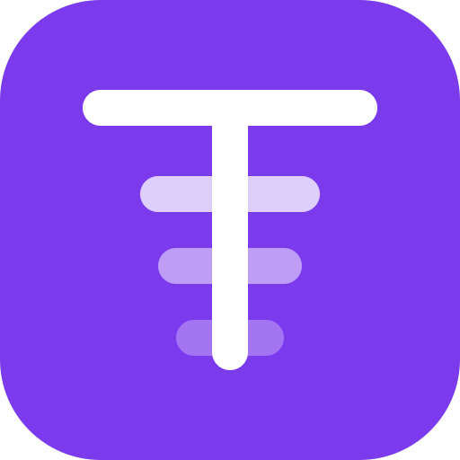

<div align="center">
  
  <h1>Tokens</h1>
  <p><strong>The leaderboard for AI coding usage — self-hosted.</strong></p>
  <p>
    <a href="./README_zh.md">中文文档</a><br />
    <a href="./CHANGELOG.md">Changelog</a> ·
    <a href="./docs/deploy/self-host-production.en.md">Deploy</a> ·
    <a href="./docs/deploy/tokens-cli-usage.en.md">CLI</a><br />
    <a href="./CHANGELOG.zh.md">更新日志</a> ·
    <a href="./docs/deploy/self-host-production.md">部署</a> ·
    <a href="./docs/deploy/tokens-cli-usage.md">手册</a>
  </p>
</div>

---

You burn tokens all day. Tokens turns that into a public standing — how much
you ran through today, how it splits across clients and models, and where you
rank against your team and everyone else doing the same thing.

This is a self-hosted fork: you run the web app and the Postgres yourself, on
your own server, under your own domain. There is no hosted instance to sign up
for — deployment is a first-class, documented path, not an afterthought.

## What it is

A leaderboard and teamboard for AI coding usage. The CLI scans the AI clients
already on your machine, totals usage locally, and submits only the totals. The
web app ranks developers globally and within Teams/Groups, with per-person
profiles, contribution graphs, and embeddable cards.

## This fork vs upstream

Fork chain: [junhoyeo/tokscale](https://github.com/junhoyeo/tokscale) →
[missuo/tokens](https://github.com/missuo/tokens) → this repository. The CLI
command set follows upstream, and parser fixes are cherry-picked onto this
fork's `1.0.x` line. The site has diverged:

| | Upstream (missuo/tokens) | This fork |
|---|---|---|
| Auth | GitHub OAuth | Email + password (PBKDF2); no GitHub sign-in |
| Organization | Single global leaderboard | Team / Group levels; Teamboard with team-single + group-multi filters |
| UI copy | English only | Full English/中文 i18n with a language switcher |
| Brand | Upstream blue | Brand purple `#7C3AED` |
| Deployment | Cloudflare Workers + Neon Postgres via Hyperdrive | Self-hosted Node (`next start`) + your own Postgres, with production Docker assets |
| Anti-cheat | Cross-device dedup, monotonicity checks, public Hall of Shame | Same guards; the public shame page is removed, bans still apply |
| Privacy | Public profiles and leaderboards | Optional private mode: hidden from public rankings; visitors see a missing user. `tokens login --private` prints a one-time read token |

**Upstream sync policy** lives in
[docs/upstream_policy.md](./docs/upstream_policy.md): data capabilities and
correctness fixes come in; UI implementations do not.

## Privacy

The CLI reads the session files your AI clients already write to disk, totals
them locally, and uploads **only the totals** — token counts, model names,
client names, timestamps. Prompts, completions, file contents and paths never
leave your machine. `tokens submit --dry-run` prints exactly what would be
uploaded. The whole pipeline is readable in `cli/tokens-core/src/sessions/`
(per-client parsers) and `cli/tokens-cli/src/commands/` (the submit path).

Because you self-host, the data sits in your own Postgres as well.

## Install the CLI and point it at your site

**macOS**

```sh
brew install owo-network/brew/tokens
```

**Linux**

```sh
curl -fsSL https://<your-domain>/install.sh | sh
```

**Windows**

```sh
npm i -g tokens-cli
```

Do not use `bunx tokens-cli@latest` to log in or submit. It skips the site pin
and talks to the upstream default. Use the pre-install script below, or set
`TOKENS_API_URL` on every command.

Then, on any platform:

```sh
tokens logout                                     # clears any credentials from another site
TOKENS_API_URL=https://<your-domain> tokens login  # browser opens <your-domain>/device
TOKENS_API_URL=https://<your-domain> tokens submit
TOKENS_API_URL=https://<your-domain> tokens login --private   # optional: hide this account
```

`TOKENS_API_URL` must be set on every command (or exported once per shell) —
the CLI defaults to the upstream site and credentials do not record which site
they belong to. The repo root also carries `pre-install-tokens.sh` /
`pre-install-tokens.ps1`, one-step onboarding scripts that install the CLI,
clear old credentials, and pin it to your site — runnable straight from the
repo's public GitHub (pinned to a reviewed tag or commit, never a moving branch):

```sh
curl -fsSL https://raw.githubusercontent.com/KunoLu/tokens/v1.0.2/pre-install-tokens.sh | bash -s -- https://<your-domain>
```

After onboarding, `enable-tokens-service.sh` (Linux) and
`register-tokens-submit-task.ps1` (Windows) set up resident auto-submission —
your deployed site serves them; the docs page shows the exact commands.

See [docs/deploy/tokens-cli-usage.en.md](./docs/deploy/tokens-cli-usage.en.md).

## Self-host the site

Production is a Node server plus a Postgres database, both yours:

- **Deploy checklist** — [docs/deploy/self-host-production.en.md](./docs/deploy/self-host-production.en.md)
  (blockers, env vars, acceptance)
- **Production Docker assets** — [docs/deploy/docker/prod/](./docs/deploy/docker/prod/)
  (multi-stage Dockerfile, compose, runbook; `docker compose up -d --build`
  deploys and redeploys)
- **Local dev stack** — [docs/deploy/docker/dev/](./docs/deploy/docker/dev/)
  (OrbStack/Docker Compose reference copy)

## Vercel (Hobby)

Separate from the Docker stack. Project `kunolu-tokens`, free
`https://kunolu-tokens.vercel.app` until a domain is purchased. See
[docs/deploy/vercel/README.en.md](./docs/deploy/vercel/README.en.md).

## Supported clients
54 clients in the scanner catalog are detected automatically — if one is
installed and has written sessions, it is counted. The docs page renders the
live list from that catalog. Parser and pricing fixes are taken from upstream;
this fork does not republish them as `27.x`.

<details>
<summary>Where each one stores its data</summary>

| Client | Data location |
|---|---|
| [Claude Code](https://docs.anthropic.com/en/docs/claude-code) | `~/.claude/projects/`, `~/.claude/transcripts/` |
| [Codex CLI](https://github.com/openai/codex) | `~/.codex/sessions/` |
| [OpenCode](https://github.com/sst/opencode) | `~/.local/share/opencode/opencode.db` (1.2+) or `~/.local/share/opencode/storage/message/` |
| [Cursor](https://cursor.com/) | API export cached at `~/.config/tokens/cursor-cache/usage*.csv` |
| [Copilot CLI](https://docs.github.com/en/copilot) | `~/.copilot/otel/*.jsonl` |
| [Gemini CLI](https://github.com/google-gemini/gemini-cli) | `~/.gemini/tmp/*/chats/*.json` |
| [Kimi CLI](https://github.com/MoonshotAI/kimi-cli) | `~/.kimi/sessions/` |
| [Qwen CLI](https://github.com/QwenLM/qwen-cli) | `~/.qwen/projects/` |
| Reasonix | `~/.reasonix/stats/*.jsonl` (override via `REASONIX_STATE_HOME` or `REASONIX_HOME`) |
| [Amp](https://ampcode.com/) | `~/.local/share/amp/threads/` |
| [Droid](https://factory.ai/) | `~/.factory/sessions/` |
| [Cline](https://github.com/cline/cline) | VS Code globalStorage tasks, or `~/.cline/data/sessions/` for the Cline CLI / desktop |
| [Roo Code](https://github.com/RooCodeInc/Roo-Code) | VS Code globalStorage tasks |
| [Kilo](https://github.com/Kilo-Org/kilocode) | VS Code globalStorage tasks |
| [Kilo CLI](https://github.com/nicepkg/kilo) | `~/.local/share/kilo/kilo.db` |
| [Crush](https://crush.ai/) | `$XDG_DATA_HOME/crush/projects.json` |
| [Goose](https://github.com/aaif-goose/goose) | `~/.local/share/goose/sessions/sessions.db` |
| [Mux](https://github.com/coder/mux) | `~/.mux/sessions/` |
| [Pi](https://github.com/badlogic/pi-mono) | `~/.pi/agent/sessions/`, `~/.omp/agent/sessions/` |
| [Zed Agent](https://zed.dev/docs/ai/agent-panel) | `~/.local/share/zed/threads/threads.db` |
| Kiro | `~/.kiro/sessions/cli/`, `~/.local/share/kiro-cli/data.sqlite3` |
| [Warp](https://www.warp.dev/) / Oz | `tokens warp sync` → `~/.config/tokens/warp-cache/usage.json` |
| [Trae](https://www.trae.ai/) | `tokens trae sync` → `~/.config/tokens/trae-cache/sessions/` |
| [Antigravity](https://antigravity.google/) | `tokens antigravity sync` → `~/.config/tokens/antigravity-cache/sessions/` |
| [OpenClaw](https://openclaw.ai/) | `~/.openclaw/agents/` |
| [Codebuff](https://codebuff.com/) | `~/.config/manicode/` |
| [Hermes](https://github.com/NousResearch/hermes-agent) | `$HERMES_HOME/state.db` |
| [Synthetic](https://synthetic.new/) | Re-attributed via `hf:` model prefix or `synthetic` provider |
| [Fx](https://github.com/vercel-labs/fx) | `~/.fx/sessions/<sessionId>/usage-v2.json` (per-session aggregates) |

</details>

### Paseo

[Paseo](https://github.com/getpaseo/paseo) runs agents through their native
providers. Usage is reported under the underlying supported client (for example,
Claude Code or Codex CLI), including sessions launched from Paseo.

For Claude and Codex profiles with separate data directories, Tokens also reads
`agents.providers` in `~/.paseo/config.json` (or `$PASEO_HOME/config.json`). It
finds absolute `env.CLAUDE_CONFIG_DIR` and `env.CODEX_HOME` paths on built-in
providers and profiles that `extends` them, including inherited base settings.
Claude projects, subagents and transcripts, plus active and archived Codex
sessions, use the existing parsers and file deduplication. Paseo's agent records
and timelines are not counted again.

Run Tokens on the daemon host, where the session files live. Relative provider
paths and paths set only in the daemon's launch environment cannot be discovered
from this config; use absolute provider paths or Tokens' existing
`scanner.extraScanPaths` setting for those installations.

Clients that expose usage only through an account API need a sync step first —
`tokens cursor sync`, `tokens antigravity sync`, `tokens trae sync`,
`tokens warp sync` — after which they submit like everything else.

Pricing comes from [LiteLLM](https://github.com/BerriAI/litellm),
[OpenRouter](https://openrouter.ai) and
[models.dev](https://github.com/anomalyco/models.dev), with the best matching
rate used per model.

## Repository layout

```text
cli/                 Rust workspace — tokens CLI (upstream command set, 1.0.x version line)
web/                 Next.js app — leaderboard, teamboard, auth, profiles, embeds
packages/            npm distribution packages (CLI + platform binaries)
docs/deploy/         Self-host deployment (checklist, Docker assets, CLI guide)
docs/archive/        Finished planning checklists, not an active tracker
CHANGELOG.md         This fork's tagged releases
web/features/        BDD behavior specs (Chinese scenarios, English keywords)
tests/e2e/           Playwright end-to-end tests
```

Project workflow rules follow the SBTD `v2.0.0-rc.4` project template plus the managed Graft block. Before changing a package or layer, read its guidelines under [docs/spec](docs/spec/); use the [lessons entry](docs/spec/lessons.md) and [lesson index](docs/lessons/index.md). Shared task history lives in `ai/tasks/`; task reports, local state and handoffs stay ignored. The retired Trellis tree is not an active workflow entry.

## License

MIT — see [LICENSE](./LICENSE).

Built on [Tokscale](https://github.com/junhoyeo/tokscale) by
[Junho Yeo](https://github.com/junhoyeo), via
[missuo/tokens](https://github.com/missuo/tokens). Credit for the original
design and implementation goes to the upstream authors and contributors.
