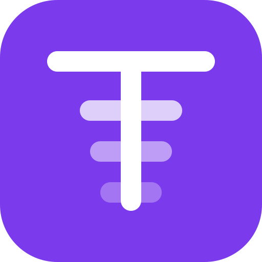

<div align="center">
  
  <h1>Tokens</h1>
  <p><strong>AI 编程用量排行榜——自托管。</strong></p>
  <p>
    <a href="./README.md">English</a><br />
    <a href="./CHANGELOG.zh.md">更新日志</a> ·
    <a href="./docs/deploy/self-host-production.md">部署</a> ·
    <a href="./docs/deploy/tokens-cli-usage.md">手册</a><br />
    <a href="./CHANGELOG.md">Changelog</a> ·
    <a href="./docs/deploy/self-host-production.en.md">Deploy</a> ·
    <a href="./docs/deploy/tokens-cli-usage.en.md">CLI</a>
  </p>
</div>

---

你每天都在烧 token。Tokens 把这些变成一份公开战绩：今天跑了多少、按客户端和模型怎么拆、你在团队和全站排第几。

这是一个**自托管 fork**：Web 应用和 Postgres 都跑在你自己的服务器、自己的域名下。没有现成的官方实例可注册——部署是一等有文档支持的路径，不是事后补的。

## 这是什么

一个面向 AI 编程用量的排行榜 + 团队榜。CLI 扫描你机器上已安装的 AI 客户端，在本地汇总用量，只提交汇总数据。Web 端提供全站榜和 Team/Group 两级组织榜，带个人主页、贡献图和可嵌入卡片。

## 本 fork 与上游的差异

Fork 链路：[junhoyeo/tokscale](https://github.com/junhoyeo/tokscale) → [missuo/tokens](https://github.com/missuo/tokens) → 本仓库。CLI 命令集跟随上游，解析器修复拣入本仓的 `1.0.x` 版本线。站点已分叉：

| | 上游（missuo/tokens） | 本 fork |
|---|---|---|
| 认证 | GitHub OAuth | 邮箱 + 密码（PBKDF2）；无 GitHub 登录 |
| 组织 | 单一全局榜 | Team / Group 两级；Teamboard 支持 Team 单选 + Group 多选筛选 |
| 文案 | English、简体中文、日本語 | English、简体中文、日本語 |
| 品牌 | 上游蓝色 | 品牌紫 `#7C3AED` |
| 部署 | Cloudflare Workers + Neon（经 Hyperdrive） | 自建 Node（`next start`）+ 自建 Postgres，带生产 Docker 资产 |
| 反作弊 | 跨设备去重、单调性校验、公开 Hall of Shame | 同样保留校验与封禁；公示页已移除 |
| 隐私 | 资料和排行榜默认公开 | 可选私密模式：不进公开排名，访客看到的和找不到用户一样。`tokens login --private` 会打印一次性读令牌 |

**上游同步策略**见 [docs/upstream_policy.md](./docs/upstream_policy.md)：数据能力与正确性修复照收，UI 实现不照搬。

## 隐私

CLI 读取的是你机器上 AI 客户端本来就会写盘的会话文件，在本地汇总后**只上传汇总数据**——token 数、模型名、客户端名、时间戳。Prompt、补全内容、文件内容与路径永远不离开你的机器。`tokens submit --dry-run` 会打印将要上传的内容。整条管线可读：`cli/tokens-core/src/sessions/`（每个客户端一个解析器）和 `cli/tokens-cli/src/commands/`（提交路径）。

因为是自托管，数据也躺在你自己的 Postgres 里。

## 安装 CLI 并指向你的站

**macOS**

```sh
brew install owo-network/brew/tokens
```

**Linux**

```sh
curl -fsSL https://<你的域名>/install.sh | sh
```

**Windows**

```sh
npm i -g tokens-cli
```

不要用 `bunx tokens-cli@latest` 登录或提交。它不会带上本站地址，会走到上游默认站。用下面的预安装脚本，或给每条命令设置 `TOKENS_API_URL`。

然后任意平台：

```sh
tokens logout                                       # 清掉其他站的旧凭据
TOKENS_API_URL=https://<你的域名> tokens login       # 浏览器打开 <你的域名>/device 授权
TOKENS_API_URL=https://<你的域名> tokens submit
TOKENS_API_URL=https://<你的域名> tokens login --private   # 可选：隐藏这个账号
```

每条命令都要带 `TOKENS_API_URL`（或在当前 shell 里 export 一次）——CLI 默认指向上游站，凭据也不记自己属于哪个站。仓库根目录还提供 `pre-install-tokens.sh` / `pre-install-tokens.ps1` 一键预安装脚本：装 CLI、清旧凭据、把默认指向固定到你的站。可直接从本仓库的 GitHub 公开地址远程执行（钉住审过的 tag 或 commit，不跟随分支漂移）：

```sh
curl -fsSL https://raw.githubusercontent.com/KunoLu/tokens/v1.0.6/pre-install-tokens.sh | bash -s -- https://<你的域名>
```

预装完成后，`enable-tokens-service.sh`（Linux）与 `register-tokens-submit-task.ps1`（Windows）可配置常驻自动提交——由你部署的站点提供下载，docs 页有现成命令，详见手册。

详见 [docs/deploy/tokens-cli-usage.md](./docs/deploy/tokens-cli-usage.md)。

## 自托管站点

生产 = 你自己的 Node 服务 + 你自己的 Postgres：

- **部署清单**——[docs/deploy/self-host-production.md](./docs/deploy/self-host-production.md)（blocker、环境变量、验收）
- **生产 Docker 资产**——[docs/deploy/docker/prod/](./docs/deploy/docker/prod/)（多阶段 Dockerfile、compose、操作手册；`docker compose up -d --build` 即部署/发版）
- **本地开发栈**——[docs/deploy/docker/dev/](./docs/deploy/docker/dev/)（OrbStack/Docker Compose 参考副本）

## Vercel（Hobby）

与 Docker 栈分开。项目名 `kunolu-tokens`，买域名之前用免费地址
`https://kunolu-tokens.vercel.app`。见
[docs/deploy/vercel/README.md](./docs/deploy/vercel/README.md)。

## 支持的客户端

扫描目录里有 57 个客户端，装过并写过会话就会被统计。文档页的列表由该目录生成。解析器和定价修复从上游拣入，本仓不把它们重新发布成 `27.x`。

<details>
<summary>各客户端的数据存放位置</summary>

| 客户端 | 数据位置 |
|---|---|
| [Claude Code](https://docs.anthropic.com/en/docs/claude-code) | `~/.claude/projects/`、`~/.claude/transcripts/` |
| [Codex CLI](https://github.com/openai/codex) | `~/.codex/sessions/` |
| [OpenCode](https://github.com/sst/opencode) | `~/.local/share/opencode/opencode.db`（1.2+）或 `~/.local/share/opencode/storage/message/` |
| [Cursor](https://cursor.com/) | API 导出缓存在 `~/.config/tokens/cursor-cache/usage*.csv` |
| [Copilot CLI](https://docs.github.com/en/copilot) | `~/.copilot/otel/*.jsonl` |
| [Gemini CLI](https://github.com/google-gemini/gemini-cli) | `~/.gemini/tmp/*/chats/*.json` |
| [Kimi CLI](https://github.com/MoonshotAI/kimi-cli) | `~/.kimi/sessions/` |
| [Qoder / Qoder CN](https://qoder.com/) | `~/.qoder/projects/` 与 `~/.qoder-cn/projects/`（可用 `QODER_CONFIG_DIR` / `QODERCN_CONFIG_DIR` 覆盖），`~/.qoder{,-cn}/logs/sessions/**/segments/`，以及 IDE 的 `SharedClientCache/cache/db/local.db`。两版都记在同一个 `qoder` 客户端下 |
| [Qwen CLI](https://github.com/QwenLM/qwen-cli) | `~/.qwen/projects/` |
| Reasonix | `~/.reasonix/stats/*.jsonl`（可用 `REASONIX_STATE_HOME` 或 `REASONIX_HOME` 覆盖） |
| [Amp](https://ampcode.com/) | `tokens amp sync` → `~/.config/tokens/amp-cache/threads/`；旧版 Amp 写入 `~/.local/share/amp/threads/` |
| [Droid](https://factory.ai/) | `~/.factory/sessions/` |
| [Cline](https://github.com/cline/cline) | VS Code globalStorage tasks，或 Cline CLI/桌面端在 `~/.cline/data/sessions/` |
| [Roo Code](https://github.com/RooCodeInc/Roo-Code) | VS Code globalStorage tasks |
| [Kilo](https://github.com/Kilo-Org/kilocode) | VS Code globalStorage tasks |
| [Kilo CLI](https://github.com/nicepkg/kilo) | `~/.local/share/kilo/kilo.db` |
| [Crush](https://crush.ai/) | `$XDG_DATA_HOME/crush/projects.json` |
| [Goose](https://github.com/aaif-goose/goose) | `~/.local/share/goose/sessions/sessions.db` |
| [Mux](https://github.com/coder/mux) | `~/.mux/sessions/` |
| [Pi](https://github.com/badlogic/pi-mono) | `~/.pi/agent/sessions/`、`~/.omp/agent/sessions/` |
| [kwwk](https://github.com/yellowplushq/kwwk) | `~/.kwwk/sessions/`。嵌入 kwwk、且每个任务自带 `.kwwk-sessions/` 目录的程序：把这些任务目录的父目录加到 `scanner.extraScanPaths.kwwk`（或 `TOKENS_EXTRA_DIRS=kwwk:<dir>`）；只读会话目录，不读旁边的代码 |
| [Zed Agent](https://zed.dev/docs/ai/agent-panel) | `~/.local/share/zed/threads/threads.db` |
| Kiro | `~/.kiro/sessions/cli/`、`~/.local/share/kiro-cli/data.sqlite3` |
| [Warp](https://www.warp.dev/) / Oz | `tokens warp sync` → `~/.config/tokens/warp-cache/usage.json` |
| [Trae](https://www.trae.ai/) | `tokens trae sync` → `~/.config/tokens/trae-cache/sessions/`（国际版账号用量 API）。Trae / Trae CN 桌面应用把聊天放在加密的 `ModularData/ai-agent/database.db`，不写可读的 token 计数 |
| [TRAE CLI](https://docs.trae.cn/cli_get-started-with-trae-cli) 2.0 | `~/.trae/cli/sessions/` 与 `~/.trae/cli/archived_sessions/`（可用 `TRAE_HOME` / `TRAECLI_HOME` 覆盖） |
| [Antigravity](https://antigravity.google/) | `~/.gemini/antigravity/conversations/*.db`、`~/.gemini/antigravity-insiders/conversations/*.db`（当前版本）；旧版本经 `tokens antigravity sync` → `~/.config/tokens/antigravity-cache/sessions/` |
| [OpenClaw](https://openclaw.ai/) | `~/.openclaw/agents/` |
| [Codebuff](https://codebuff.com/) | `~/.config/manicode/` |
| [Hermes](https://github.com/NousResearch/hermes-agent) | `$HERMES_HOME/state.db` |
| [Synthetic](https://synthetic.new/) | 经 `hf:` 模型前缀或 `synthetic` provider 重新归因 |
| [Fx](https://github.com/vercel-labs/fx) | `~/.fx/sessions/<sessionId>/usage-v2.json`（按会话聚合） |

</details>

`--client claude` 指 Claude Code。Claude 网页、桌面和移动应用里的对话（含 Projects）不统计：这些应用不在本地保存逐条消息的 token 数，tokens 也不读取 claude.ai 账号。网页版 Claude Code 另计，见 [云端会话](./docs/cloud-sessions.md)。

只通过账号 API 暴露用量的客户端需要先做一次同步——`tokens cursor sync`、`tokens antigravity sync`、`tokens trae sync`、`tokens warp sync`——之后就和其它客户端一样提交。Antigravity 只在旧版本上需要这次同步：当前 Antigravity 与 Antigravity - Insiders 的会话数据库会直接读取（`tokens antigravity status` 会显示找到了哪些）。

定价数据来自 [LiteLLM](https://github.com/BerriAI/litellm)、[OpenRouter](https://openrouter.ai) 和 [models.dev](https://github.com/anomalyco/models.dev)，按模型取最优匹配费率。

### Amp 线程同步

新版 Amp 将线程保存在 ampcode.com，包括在 Amp 云端运行的线程。安装并登录本机 `amp` CLI 后，运行 `tokens amp sync` 主动启用同步。`tokens amp status` 显示检测到的可执行文件、缓存路径、已缓存线程数和上次同步时间，不运行 `amp`，也不访问 Amp。两个命令都支持 `--json`。

同步用 `amp threads list --json --include-archived --limit 500 --offset <offset>` 分页读取列表。它还用 `amp threads search author:me --json --limit 100` 补充列表可能漏掉的近期活跃线程，并获取更新的活动时间戳。新建、变更或缺少缓存文件的线程通过 `amp threads export <thread-id>` 导出。`tokens amp sync --force` 会重新导出所有找到的线程。

Tokens 不读取 Amp 凭据；本机 `amp` CLI 使用自己的登录状态。`<Tokens 配置目录>/amp-cache/threads/T-<id>.json` 只保存用量元数据，不写入提示词、回复、工具输出或线程标题。macOS 和 Linux 的配置目录通常为 `~/.config/tokens`，可用 `TOKENS_CONFIG_DIR` 覆盖；`tokens amp status` 显示实际缓存路径。

手动同步写入 `<Tokens 配置目录>/amp-cache/state.json` 后，只要提交包含 Amp，`tokens submit` 和 `tokens serve` 就会增量刷新缓存。未主动启用前，它们不会访问 Amp。刷新失败时，提交继续使用已有缓存。扫描器也读取 `~/.local/share/amp/threads/`（或 `$XDG_DATA_HOME/amp/threads/`）里的旧版文件；两处有相同线程 ID 时，只统计同步缓存中的副本。

Amp 导出仅包含主代理请求，不含子代理（`Task`）请求，也不含生成标题等系统模型请求。上游一次抽样中，同步的 token 总量比 `amp usage` 约少 15%，这不是固定差值。首次同步还可能漏掉不在 `threads list` 中的旧线程：`threads search` 只返回最近活跃的 100 条。

## 仓库结构

```text
cli/                 Rust workspace——tokens CLI（命令集跟随上游，版本线 1.0.x）
web/                 Next.js 应用——排行榜、团队榜、认证、个人主页、embed
packages/            npm 分发包（CLI 主包 + 各平台二进制）
docs/deploy/         自托管部署（清单、Docker 资产、CLI 手册）
docs/archive/        已完成的规划清单，不是当前推进依据
CHANGELOG.zh.md      本 fork 已打 tag 的版本说明
docs/upstream_policy.md   上游改动的评估与合并策略
web/features/        BDD 行为规格（中文场景 + 英文关键词）
tests/e2e/           Playwright 端到端测试
```

项目工作流规则采用 SBTD `v2.0.0-rc.4` 项目模板及受管 Graft 块。修改包或层之前先读 [docs/spec](docs/spec/) 对应规范；经验记录从[短入口](docs/spec/lessons.md)及[索引](docs/lessons/index.md)按需读取。共享任务历史位于 `ai/tasks/`，任务报告、本地状态与 handoff 保持忽略；已退役 Trellis 树不再作为有效工作流入口。

## 许可证

MIT——见 [LICENSE](./LICENSE)。

基于 [Tokscale](https://github.com/junhoyeo/tokscale)（作者 [Junho Yeo](https://github.com/junhoyeo)），经由 [missuo/tokens](https://github.com/missuo/tokens)。原始设计与实现的 credit 归上游作者与贡献者。
